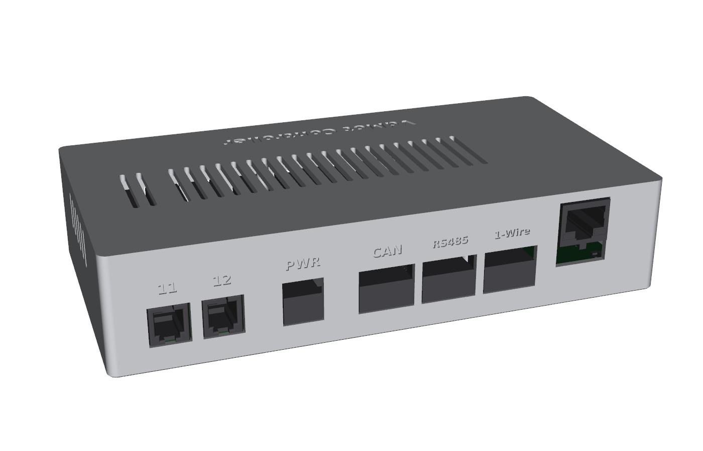
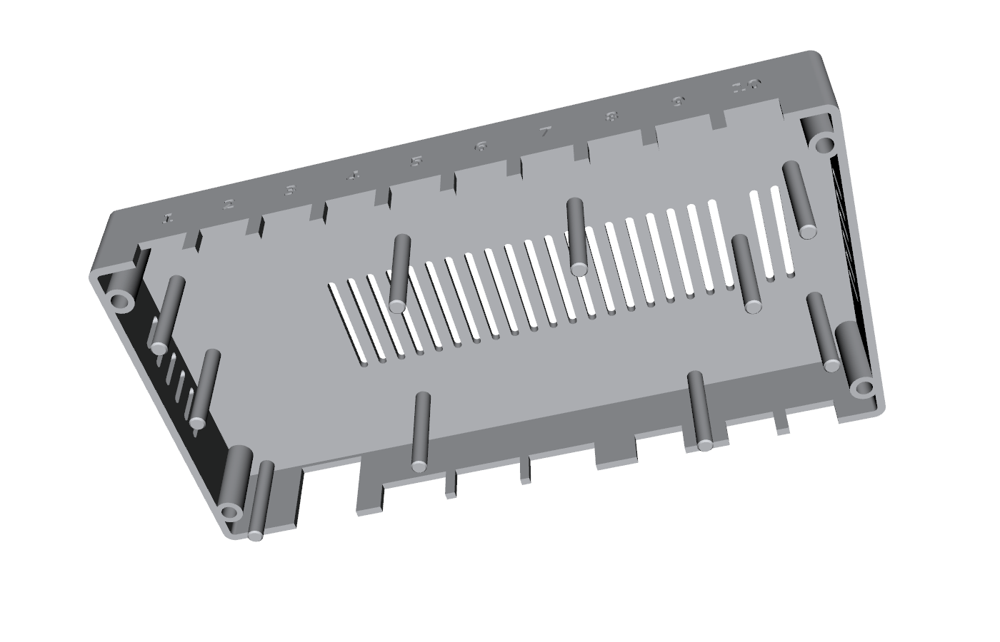

# 3D-printable enclosure

A two-part enclosure for the VdMot_Controller PCB (C2/C3 sample), with an
optional clip for 35 mm DIN rails (TS35). It is an alternative to the apra
Rail DB housing described in [../hardware.md](../hardware.md).


| Front (valve jacks 1-10) | Back (LAN, terminals, jacks 11/12) |
| --- | --- |
|  |  |

| Lid from below | Bottom with DIN rail clip |
| --- | --- |
|  |  |

Outer size: 171.8 x 90.6 x 37.0 mm (with DIN clip: +6 mm height).

## Files

| File | Content |
| --- | --- |
| `models/vdmot_enclosure_base.stl` | base, print orientation |
| `models/vdmot_enclosure_lid.stl` | lid, print orientation (roof on the bed) |
| `models/vdmot_enclosure_din_clip.stl` | optional DIN rail clip, print orientation |
| `models/*.step` | the same parts in assembly position (PCB coordinate frame) |
| `enclosure.py` | parametric CadQuery source of all parts |
| `check_fit.py` | collision check of the parts against the PCB STEP model |

## Design

- The PCB has no mounting holes. It rests on a ledge (1.8 mm wide) along all
  four board edges in the base. Ten pins in the lid press on free spots of the
  PCB and clamp it onto the ledge.
- The base and the lid meet 5 mm above the PCB top. All connector windows are
  split at that plane, so the PCB drops into the base from above and the lid
  is put on from above.
- Front: windows for the ten valve jacks X1..X10, engraved with 1..10. The
  jacks are recessed by 0.5 mm, so the latch of the RJ plug works.
- Back: windows for the RJ45 of the WT32-ETH01 (LAN), the pluggable terminals
  X18 (1-Wire), X17 (RS485), X19 (CAN), X13 (power) and the jacks X12/X11.
  The terminal windows are 13 mm high, so the mating plugs fit through.
- Ventilation slots in the roof, both end walls and the floor.
- Four M3 screws from below through the base into the lid towers.
- The DIN clip is screwed to the floor with two M3 screws. Without the clip,
  the same two holes can be used to screw the base to a wall.

## Printing

- Material: PETG or ASA recommended (the DIN clip latch is a spring, and the
  enclosure may sit in a warm distribution box). PLA works for base and lid.
- 0.2 mm layers, 3 perimeters, 15-20 % infill.
- No supports needed. Print orientation is already set in the STL files:
  - base: floor on the bed
  - lid: roof on the bed (the engraved title is on the first layers)
  - DIN clip: mounting face on the bed; the hook lips have a short (~2 mm)
    overhang that prints fine without support

## Parts list

| Qty | Part | Used for |
| --- | --- | --- |
| 4 | M3 heat-set insert, outer d 4.0-4.2 mm, length <= 6 mm | lid towers |
| 4 | M3 x 16 screw, ISO 7380 (button head) or ISO 4762 | base to lid |
| 2 | M3 x 8 screw, ISO 7380 (button head) | DIN clip (optional) |
| 2 | M3 hex nut, ISO 4032 | DIN clip (optional) |

Without heat-set inserts set `LID_HOLE_MODE = "tap"` in `enclosure.py` and
regenerate: the lid towers then get 2.6 mm holes for screwing M3 directly into
the plastic.

## Assembly

1. Optional: screw the DIN clip to the bottom of the base. The M3 x 8 button
   head screws go from inside the base, the nuts sit in the traps of the clip.
   The release tab of the latch points to the same side as the valve jacks.
2. Press the heat-set inserts into the four lid towers.
3. Trim the THT leads on the bottom side of the PCB to <= 2.5 mm.
4. Put the PCB into the base, valve jacks to the front.
5. Put on the lid and fasten it with the four M3 x 16 screws from below.

To mount it on the rail, hook the fixed side of the clip (terminal side of the
enclosure) over one rail edge and push the lower side onto the rail until the latch snaps in. To remove
it, pull the release tab with a screwdriver.

## Modifying

```bash
pip install cadquery
python3 enclosure.py               # writes models/*.stl and models/*.step
python3 enclosure.py --no-text     # without engraved labels
```

All dimensions are parameters at the top of `enclosure.py` (clearances, wall
thickness, split height, screw type, pin positions, labels, ...).

After changes, check the parts against the PCB model. Extract
`../c3-sample_3D.rar` (e.g. with `unar`) and run:

```bash
python3 check_fit.py path/to/c3-sample_3D.step
```

It reports every component that intersects a part and fails if there is any.

## Notes and limitations

- Designed from the C3-sample STEP model (`../c3-sample_3D.rar`). The C2-sample
  uses the same schematic and connector layout (see the C2 assembly drawing),
  but only the C3 model was checked. The C4-sample moved the RJ12 jacks closer
  to the board edge and is not covered.
- The STEP model exports the PCB only 0.44 mm thick. The enclosure assumes a
  standard 1.6 mm board (parameter `PCB_T`).
- The model contains only the PCB side of the pluggable terminals. Check the
  fit of your mating plugs (CTB9209) in the 13 mm high windows.
- USB-C of the BlackPill, the jumpers and the button S1 are only accessible
  with the lid removed.
