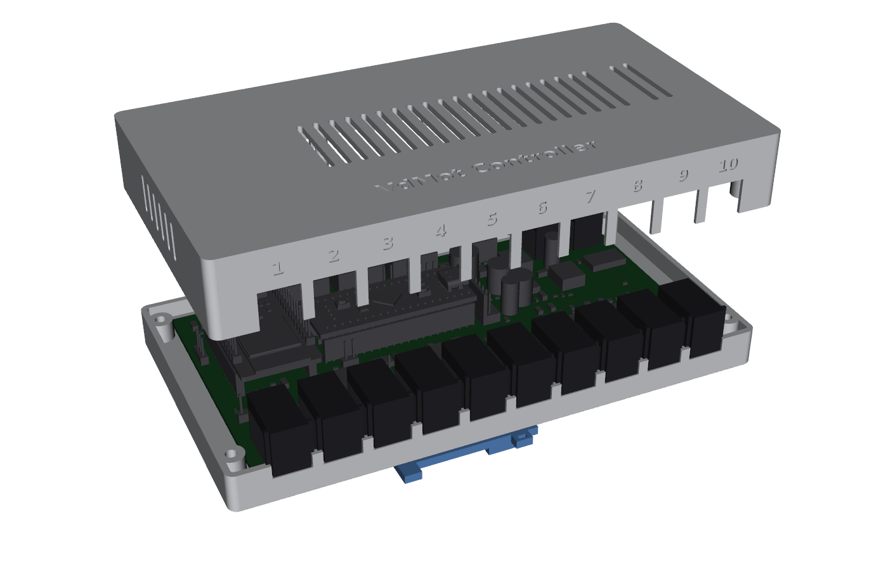
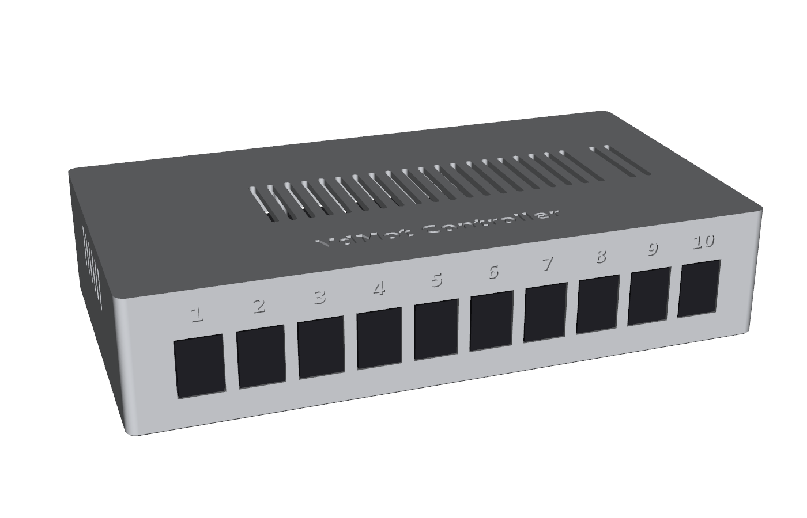
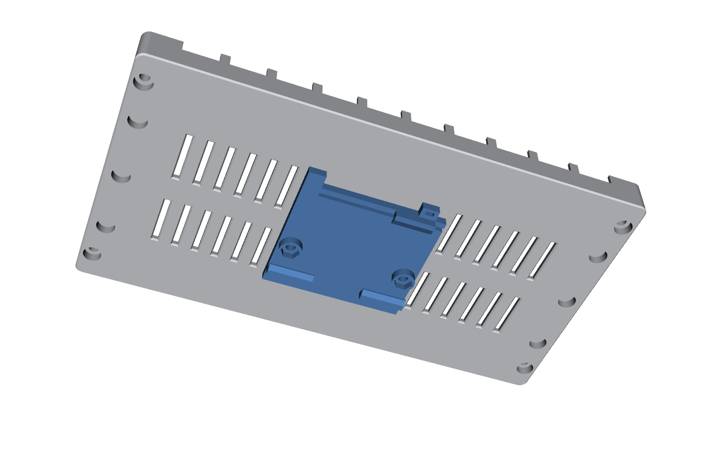
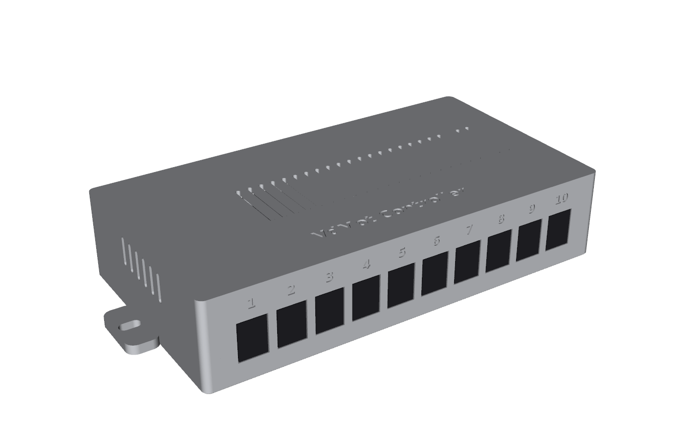

# 3D-printable enclosure

A two-part enclosure for the VdMot_Controller PCB (C2/C3 sample). It can be
mounted on a 35 mm DIN rail (TS35, optional clip), screwed to a wall (base
variant with tabs) or held by magnets on a steel plate. It is an alternative to
the apra Rail DB housing described in [../hardware.md](../hardware.md).



| Front (valve jacks 1-10) | Back (LAN, terminals, jacks 11/12) |
| --- | --- |
|  |  |

| Lid from below | Bottom with DIN rail clip and magnet pockets |
| --- | --- |
|  |  |

| Base variant with screw tabs |
| --- |
|  |

The modular jacks are shown as their datasheet envelope (dark boxes).

Outer size: 173.8 x 94.6 x 37.0 mm (DIN clip: +6 mm height, screw tabs: +24 mm
length).

## Files

| File | Content |
| --- | --- |
| `models/vdmot_enclosure_base.stl` | base, print orientation |
| `models/vdmot_enclosure_base_wallmount.stl` | base with screw tabs for wall mounting, print orientation |
| `models/vdmot_enclosure_lid.stl` | lid, print orientation (roof on the bed) |
| `models/vdmot_enclosure_din_clip.stl` | optional DIN rail clip, print orientation |
| `models/*.step` | the same parts in assembly position (PCB coordinate frame) |
| `enclosure.py` | parametric CadQuery source of all parts |
| `check_fit.py` | collision check of the parts against the PCB STEP model |

## Design

- The PCB has no mounting holes. It rests on a ledge (1.8 mm wide) along all
  four board edges in the base. Ten pins in the lid press on free spots of the
  PCB and clamp it onto the ledge.
- The base and the lid meet 5 mm above the PCB top. All connector windows are
  split at that plane, so the PCB drops into the base from above and the lid
  is put on from above.
- Valve jacks X1..X12 (4P4C, MEBP 4-4S): the walls are built from the jack
  datasheet. The jack front sits flush with the outside (0.1 mm recess). The
  outer skin is 1.0 mm thick (the panel stop flanges of the jacks expect up to
  1.2 mm) and has a wider relief behind it for the flanges. The window starts
  0.5 mm above the PCB, because the jack body is raised at its front.
- The back jacks X11/X12 sit about 0.5 mm deeper than footprint and datasheet
  suggest (measured on a test print); `BACK_JACK_CORR` compensates for it.
- Front: windows for the jacks X1..X10, engraved with 1..10.
- Back: windows for the RJ45 of the WT32-ETH01 (LAN), the pluggable terminals
  X18 (1-Wire), X17 (RS485), X19 (CAN), X13 (power) and the jacks X12/X11.
  The terminal windows are as high as the headers (8.4 mm + clearance). Below
  the RJ45 the base wall rises up to the connector, so there is no open gap.
- Ventilation slots in the roof, both end walls and the floor.
- Four M3 screws from below through the base into heat-set inserts in the lid.

## Mounting options

- **DIN rail:** print the DIN clip and screw it to the floor with two M3 x 8
  screws and nuts.
- **Wall or plate, screws:** print `vdmot_enclosure_base_wallmount.stl`
  instead of the base. It has a tab at both ends with a 4.5 mm slot for screws
  up to 4 mm. The screws stay accessible with the lid on.
  Alternatively, the two DIN clip holes in the floor of the standard base can
  take screws, but only with the PCB removed.
- **Steel plate, magnets:** both bases have six pockets for 6 x 3 mm disc
  magnets in the bottom of the end blocks, away from the electronics. The
  board has no magnetic sensors or relays (C2/C3), so the magnets do not
  affect it. Press the magnets in and secure them with a drop of glue. Set
  `MAGNET = False` to remove the pockets.

## Printing

- Material: PETG or ASA recommended (the DIN clip latch is a spring, and the
  enclosure may sit in a warm distribution box). PLA works for base and lid.
- 0.2 mm layers, 3 perimeters, 15-20 % infill.
- No supports needed. Print orientation is already set in the STL files:
  - base: floor on the bed
  - lid: roof on the bed (the engraved title is on the first layers)
  - DIN clip: mounting face on the bed; the hook lips have a short (~2 mm)
    overhang that prints fine without support

## Parts list

| Qty | Part | Used for |
| --- | --- | --- |
| 4 | M3 heat-set insert, length <= 6 mm (tip d ~4.0, knurl d ~4.6-5.0) | lid towers |
| 4 | M3 x 16 screw, ISO 7380 (button head) or ISO 4762 | base to lid |
| 2 | M3 x 8 screw, ISO 7380 (button head) | DIN clip (optional) |
| 2 | M3 hex nut, ISO 4032 | DIN clip (optional) |
| 6 | disc magnet 6 x 3 mm (NdFeB) | magnet mounting (optional) |

The insert holes are 4.3 mm with a lead-in chamfer. If they still come out too
tight or too loose on your printer, adjust `INSERT_D`. Without heat-set inserts
set `LID_HOLE_MODE = "tap"` and regenerate: the lid towers then get 2.6 mm
holes for screwing M3 directly into the plastic.

## Assembly

1. Optional: screw the DIN clip to the bottom of the base. The M3 x 8 button
   head screws go from inside the base, the nuts sit in the traps of the clip.
   The release tab of the latch points to the same side as the valve jacks.
2. Optional: glue the magnets into the pockets.
3. Press the heat-set inserts into the four lid towers.
4. Trim the THT leads on the bottom side of the PCB to <= 2.5 mm.
5. Put the PCB into the base, valve jacks to the front.
6. Put on the lid and fasten it with the four M3 x 16 screws from below.

To mount it on the rail, hook the fixed side of the clip (terminal side of the
enclosure) over one rail edge and push the other side onto the rail until the
latch snaps in. To remove it, pull the release tab with a screwdriver.

## Modifying

```bash
pip install cadquery
python3 enclosure.py               # writes models/*.stl and models/*.step
python3 enclosure.py --no-text     # without engraved labels
```

All dimensions are parameters at the top of `enclosure.py` (clearances, wall
thickness, split height, jack dimensions, screw type, pin positions, magnets,
labels, ...).

After changes, check the parts against the PCB model. Extract
`../c3-sample_3D.rar` (e.g. with `unar`) and run:

```bash
python3 check_fit.py path/to/c3-sample_3D.step
```

It reports every component that intersects a part and fails if there is any.

## Notes and limitations

- Designed from the C3-sample STEP model (`../c3-sample_3D.rar`) and the
  datasheet of the MEBP 4-4S jacks. The STEP model contains a smaller jack
  (11.5 mm high, 1.8 mm overhang), only its pegs match the real part. The real
  jacks are 16 mm high and stick out about 4.4 mm over the PCB edge; the enclosure
  uses the datasheet values, and `check_fit.py` checks against both.
- The C2-sample uses the same schematic and connector layout (see the C2
  assembly drawing), but only the C3 model was checked. The C4-sample moved the
  RJ12 jacks closer to the board edge and is not covered.
- The STEP model exports the PCB only 0.44 mm thick. The enclosure assumes a
  standard 1.6 mm board (parameter `PCB_T`).
- The model contains only the PCB side of the pluggable terminals (CTB9359).
  The windows are sized for the header; the plug (CTB9202) enters the header
  through the same opening, its screw flanges stay outside. Increase
  `TERMINAL_H` if your plugs do not fit.
- USB-C of the BlackPill, the jumpers and the button S1 are only accessible
  with the lid removed.
